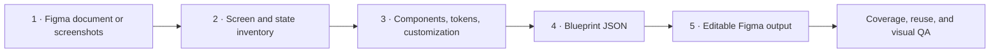

# Figma UI Blueprint Builder

[English](./README.md) | [简体中文](./README.zh-CN.md)

[](https://github.com/pilapipi/figma-ui-blueprint-builder/actions/workflows/quality.yml)
[](https://github.com/pilapipi/figma-ui-blueprint-builder/actions/workflows/security.yml)
[](./LICENSE)

A generic workflow and local Figma development plugin for turning design
documents or screenshots into reusable components and editable screens.

The runtime contains no product-specific flows, brand names, or fixed screen
counts. Each project is described by an independent `blueprint.json` containing
its tokens, components, sections, screens, assets, and layers.

## Workflow



1. **Collect the source.** Use an accessible Figma URL, a copied `.fig` file,
   exported screenshots, a PDF, or a mixture of these.
2. **Inventory the product.** Record every source screen, flow, state, viewport,
   and rebuild/merge/omit decision.
3. **Decompose and customize.** Define reusable components, tokens, responsive
   behavior, information architecture, and project-specific requirements.
4. **Author a Blueprint.** Express the approved system through the versioned
   JSON Schema.
5. **Generate and verify.** The local plugin creates variables, styles, master
   components, instances, and editable screen frames in Figma.

The plugin is a deterministic renderer, not a visual AI model. Screenshot
interpretation and product decisions happen before Blueprint authoring.

## What it generates

- Figma color Variables and Text Styles.
- A dedicated Component Library Section.
- Master components and reusable instances.
- Screen components or ordinary Frames.
- Auto Layout containers and nested editable layers.
- Sections arranged from any number of screens in the Blueprint.
- Shared Plugin Data tags that isolate generated content from user content.

Supported layer types:

| Type | Purpose |
| --- | --- |
| `frame` | Containers, Auto Layout, and nested structure |
| `text` | Copy, typography tokens, and alignment |
| `rectangle` | Surfaces, cards, and regions |
| `ellipse` | Avatars, circles, and state indicators |
| `line` | Dividers and timelines |
| `instance` | Reusable Blueprint components with text overrides |
| `svg` | Editable vector icons and illustrations |
| `image` | Embedded project image assets |

## Source material

The plugin UI can:

- place multiple local PNG/JPG files into a locked Source References Section;
- inspect the current Figma selection;
- report node names, types, dimensions, layout modes, fills, and up to three
  child levels.

Reference screenshots are evidence, not final screens. Production output should
rebuild text, containers, vectors, Auto Layout, components, and instances.

## Quick start

Requirements:

- Figma Desktop;
- Node.js 20.19, 22.13, or a newer supported release;
- npm 9 or later.

```bash
git clone https://github.com/pilapipi/figma-ui-blueprint-builder.git
cd figma-ui-blueprint-builder
npm ci
npm run build
```

In Figma Desktop:

1. Open the target Design file.
2. Choose **Plugins → Development → Import plugin from manifest…**.
3. Select `manifest.json` from this repository.
4. Open **Plugins → Development → UI Blueprint Builder**.
5. Import a `blueprint.json`.
6. Validate it, then generate the components and screens.

The checked-in manifest uses the maintainers' development plugin ID. If Figma
reports an ID conflict, create a new local development plugin and replace only
the `id` in `manifest.json`.

## Start a project

```bash
npm run new:project -- travel-app "Travel App"
```

This creates:

```text
projects/travel-app/
├── assets/
├── PROJECT_BRIEF.md
├── SOURCE_INVENTORY.md
├── COMPONENT_MAP.md
└── blueprint.json
```

Complete the three review documents before editing the Blueprint:

```bash
npm run validate -- projects/travel-app/blueprint.json
npm run build
```

Project assets are ignored by Git by default so client screenshots are not
accidentally committed.

## Blueprint interface

```text
Project
├── Source metadata
├── Tokens
│   ├── Colors
│   ├── Typography
│   ├── Spacing
│   └── Radii
├── Assets
├── Components
└── Sections
    └── Screens
        └── Layers / Component Instances
```

- JSON Schema:
  [`schema/blueprint.schema.json`](./schema/blueprint.schema.json)
- Field reference: [`docs/BLUEPRINT.md`](./docs/BLUEPRINT.md)
- Delivery workflow: [`docs/WORKFLOW.md`](./docs/WORKFLOW.md)
- Minimal example:
  [`examples/memory-music/blueprint.json`](./examples/memory-music/blueprint.json)

Screen counts are derived from `sections[].screens`; they are never runtime
constants.

## Update modes

`project.buildMode` supports:

- `replace-generated` — remove and rebuild only tagged output from the same
  project and section;
- `preserve-existing` — retain generated components and screens so manual Figma
  changes are not overwritten.

Untagged user content is never removed. Back up important Figma files before
large regeneration runs.

## Development

```bash
# TypeScript → code.js
npm run build

# Watch compilation
npm run watch

# Validate one or more Blueprints
npm run validate -- path/to/blueprint.json

# Lint, validate examples, and build
npm run check
```

Repository layout:

```text
.
├── code.ts
├── ui.html
├── manifest.json
├── schema/blueprint.schema.json
├── docs/
├── templates/project/
├── examples/memory-music/
├── tools/
└── .github/workflows/
```

The architecture boundary is deliberate:

- domain content belongs in project Blueprints;
- examples stay small and generic;
- the runtime must not contain a customer name, fixed page count, or
  product-specific phase;
- extend the Schema and renderer only for reusable capabilities.

## Privacy and security

- The Figma manifest allows no network access.
- Source screenshots remain in the local Figma document.
- `projects/*/assets/` is ignored by default.
- Do not commit private Figma URLs, personal data, voice samples, payment data,
  identity material, or client screenshots.
- Report vulnerabilities privately according to [SECURITY.md](./SECURITY.md).

## Community

- Read [CONTRIBUTING.md](./CONTRIBUTING.md) before opening a pull request.
- Use GitHub Discussions for usage and design questions.
- Use Issues for reproducible bugs and generic feature requests.
- Follow the [Code of Conduct](./CODE_OF_CONDUCT.md).
- Project governance is described in [GOVERNANCE.md](./GOVERNANCE.md).

## License

Copyright 2026 广州派拉披披科技有限公司 (pilapp).

Licensed under the [Apache License 2.0](./LICENSE). The license does not grant
permission to use pilapp trademarks, trade names, or product branding except as
required for reasonable and customary attribution.
