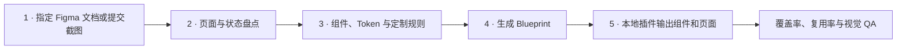

# Figma UI Blueprint Builder

[English](./README.md) | 简体中文

一套通用的“设计文档 / 截图 → 组件拆解 → 定制规则 → Figma 插件输出”工作流。

它不是某个品牌、某组页面或固定数量 UI 的生成脚本。每个项目用独立的
`blueprint.json` 描述 Tokens、组件、页面组、状态和图层；同一个 Figma 本地
插件运行时可以构建任意符合 Schema 的 Blueprint。

- 当前版本：`v2.0.0`
- 输入：Figma 文档、复制的 `.fig` 文件、截图 / PDF 导出，或混合来源
- 中间产物：Project Brief、Source Inventory、Component Map、Blueprint
- 输出：Figma Variables、Text Styles、主组件、实例和可编辑页面
- 网络权限：无
- 固定业务页面数量：无

> 插件负责把已经完成的分析和组件拆解稳定地写入 Figma。视觉理解、产品判断和
> 定制化拆解由 Codex / 设计师在编写 Blueprint 之前完成，不应把“自动扫描截图”
> 和“设计决策”混为一步。

## 适用流程



### 1. 获取来源

用户可以提供：

- 可访问的 Figma 文件 URL。
- 复制到用户账号或本地 Figma Desktop 的文件。
- `.fig` 本地副本。
- 按页面导出的 PNG、JPG 或 PDF。
- 已放入 Figma 画布的截图集合。

如果源文件无法授权、图层本来就是扁平图片，或账号套餐限制访问，直接要求用户
复制文件或导出截图即可。插件的“来源材料”区域可以把本地截图整齐放到当前
Figma 文件，作为锁定参考板；截图不会被误当作最终 UI。

### 2. 拆解页面和组件

在开始生成前，先提交三份可审查产物：

1. `PROJECT_BRIEF.md`：来源、目标平台、页面范围和验收条件。
2. `SOURCE_INVENTORY.md`：每张截图对应的流程、状态、尺寸和输出决策。
3. `COMPONENT_MAP.md`：重复模式、组件边界、变体、Tokens 和定制规则。

这一步负责识别：

- 稳定页面结构与一次性视觉装饰。
- 可复用组件与页面特有模块。
- 默认、加载、空态、错误、成功、权限、确认等状态。
- 导航层级、内容优先级和响应式关系。
- 应保留、合并、重构或删除的旧设计。

### 3. 应用定制需求

定制不是在生成后零散修补，而是先进入 Brief 和 Component Map，再落实到
Blueprint。常见定制包括：

- 新品牌 Tokens 和视觉语言。
- 指定组件库或命名规范。
- 移动端、平板、桌面端尺寸。
- 页面合并、流程重排、信息层级调整。
- 本地化、无障碍、暗色模式。
- 特定页面数量或组件数量的严格验收。

### 4. 封装 Blueprint

Blueprint 是项目分析和插件之间的稳定接口：

```text
Project
├── Source metadata
├── Tokens
│   ├── Colors
│   ├── Typography
│   ├── Spacing
│   └── Radii
├── Assets
├── Components
└── Sections
    └── Screens
        └── Layers / Component Instances
```

Schema 位于
[`schema/blueprint.schema.json`](./schema/blueprint.schema.json)，完整字段说明见
[`docs/BLUEPRINT.md`](./docs/BLUEPRINT.md)。

### 5. 插件输出

Figma 插件会：

- 创建或更新颜色 Variables 和 Text Styles。
- 创建单独的 Component Library Section。
- 用组件实例装配页面。
- 按 Blueprint Section 分组和排版页面。
- 将页面输出为主组件或普通 Frame。
- 通过 Shared Plugin Data 只替换本工具生成的内容。
- 保留所有未带工具标签的用户图层。

## 快速开始

### 安装和构建

```bash
git clone https://github.com/pilapipi/figma-ui-blueprint-builder.git
cd figma-ui-blueprint-builder
npm ci
npm run build
```

环境要求：

- Figma Desktop
- Node.js 20.19、22.13 或更高受支持版本
- npm 9 或更高版本

### 导入 Figma

1. 在 Figma Desktop 打开目标 Design 文件。
2. 进入 **Plugins → Development → Import plugin from manifest…**。
3. 选择仓库根目录的 `manifest.json`。
4. 打开 **Plugins → Development → UI Blueprint Builder**。
5. 导入项目的 `blueprint.json`。
6. 先点击“验证”，再点击“生成组件与页面”。

### 新建一个项目

```bash
npm run new:project -- travel-app "Travel App"
```

会创建：

```text
projects/travel-app/
├── assets/
├── PROJECT_BRIEF.md
├── SOURCE_INVENTORY.md
├── COMPONENT_MAP.md
└── blueprint.json
```

按顺序补完前三份分析文件，再编辑 Blueprint：

```bash
npm run validate -- projects/travel-app/blueprint.json
npm run build
```

然后在插件中导入该 `blueprint.json`。

## 插件能力

### 来源辅助

- 批量选择本地 PNG / JPG 并放入 Figma 参考 Section。
- 锁定参考图片，避免把它们误编辑成成品。
- 扫描当前选区并输出节点名、类型、尺寸、布局和三层子节点结构。

扫描报告只提供结构元数据，不会假装完成视觉分析。Codex 或设计师仍需观察截图
内容并完成页面与组件判断。

### Blueprint 渲染

支持的页面图层：

| 类型 | 用途 |
| --- | --- |
| `frame` | 容器、Auto Layout、嵌套结构 |
| `text` | 文案、Typography Token、对齐 |
| `rectangle` | 背景、卡片、分割区 |
| `ellipse` | 头像、圆形装饰、状态点 |
| `line` | 分割线、时间轴 |
| `instance` | 复用 Blueprint 主组件并覆盖文本 |
| `svg` | 可编辑矢量图标和插画 |
| `image` | 使用 Blueprint 内嵌图片资产 |

样式支持：

- 颜色 Token、纯色和线性渐变。
- Typography Token 和本机字体回退。
- Spacing / Radius Token。
- Auto Layout、Padding、Gap、对齐和拉伸。
- 边框、圆角、阴影、透明度、旋转和裁切。
- 组件文本覆盖。

### 两种更新模式

`project.buildMode` 支持：

- `replace-generated`：默认。删除同一项目、同一 Section 的旧生成结果后重建；
  不碰用户手工创建的其他内容。
- `preserve-existing`：保留已生成组件和页面，不覆盖人工调整；适合交付后的增量检查。

重要版本前仍建议先复制 Figma 文件作为备份。

## 常用命令

```bash
# 编译 code.ts → code.js
npm run build

# 持续编译
npm run watch

# 验证一个或多个 Blueprint
npm run validate -- path/to/blueprint.json

# 创建项目目录
npm run new:project -- project-id "Project Name"

# ESLint、工具脚本、Schema、示例和 TypeScript 全量检查
npm run check
```

GitHub Actions 会在每次 push 和 pull request 中运行 `npm ci` 和
`npm run check`。

## 仓库结构

```text
.
├── AGENTS.md                       # Codex / Agent 执行协议
├── code.ts                         # 通用 Figma Blueprint 运行时
├── ui.html                         # 来源、扫描、验证和生成面板
├── manifest.json                   # Figma 本地插件清单
├── schema/blueprint.schema.json    # Blueprint JSON Schema
├── docs/
│   ├── WORKFLOW.md                 # 五阶段交付流程
│   └── BLUEPRINT.md                # Blueprint 字段参考
├── templates/project/              # 新项目分析模板
├── examples/memory-music/          # 与业务无关的两页最小示例
├── tools/
│   ├── new-project.mjs
│   └── validate-blueprint.mjs
└── .github/workflows/quality.yml
```

## 设计原则

### 截图是证据，不是成品

参考截图可以锁定保留，但最终 UI 必须重新建立文本、容器、图标、组件实例和
Auto Layout。除确实属于内容资产的照片外，不把整页截图作为最终页面背景。

### 先覆盖流程，再追求视觉

第一道验收是页面和状态覆盖率；第二道是组件复用和命名；第三道才是逐像素视觉
校准。这样能避免先精修两张图，最后才发现流程缺页。

### 页面数量不是引擎常量

引擎从 `sections[].screens` 计算页面数量。项目要求 2 页、50 页或 200 页都只
影响 Blueprint，不需要修改运行时。

### 定制进入配置，不进入分支堆叠

品牌色、文案、尺寸、组件和页面状态应进入 Blueprint。只有现有 Layer DSL 无法
表达的新能力，才扩展 Schema 和通用渲染器；不要在 `code.ts` 中加入某个客户名
或某个页面数量的专用分支。

## 图片与隐私

- 插件清单禁止网络访问。
- 来源截图只在本地 Figma 文件中处理。
- `projects/*/assets/` 默认被 Git 忽略，避免误提交客户截图。
- Blueprint 的 `assets` 可以内嵌 base64 图片，但大图片会显著增加 JSON 体积。
- 私密 Figma URL、用户数据、声音、支付和身份素材不应提交到公共仓库。

## 限制

- 插件本身不包含视觉大模型，不会自动理解截图中的产品逻辑。
- 扁平截图无法恢复原始约束；组件边界和响应式行为必须通过分析重建。
- 字体取决于运行插件的电脑，缺失字体会回退到可用字体。
- 组件文本覆盖目前通过 Text Layer 名称匹配。
- 复杂矢量建议使用 `svg`，照片使用 `image`，不要用数百个矩形模拟位图。

## 开源协作

- 提交代码前请阅读 [CONTRIBUTING.md](./CONTRIBUTING.md)。
- 使用 GitHub Discussions 讨论使用方法与 Blueprint 建模。
- 使用 Issues 提交可复现问题和通用功能需求。
- 安全漏洞请按照 [SECURITY.md](./SECURITY.md) 私下报告。
- 所有社区参与者均须遵守 [CODE_OF_CONDUCT.md](./CODE_OF_CONDUCT.md)。
- 项目治理方式见 [GOVERNANCE.md](./GOVERNANCE.md)。

## License

Copyright 2026 广州派拉披披科技有限公司（pilapp）。

本项目使用 [Apache License 2.0](./LICENSE) 开源。该许可证不授予 pilapp 的
商标、品牌名称或产品标识使用权。
